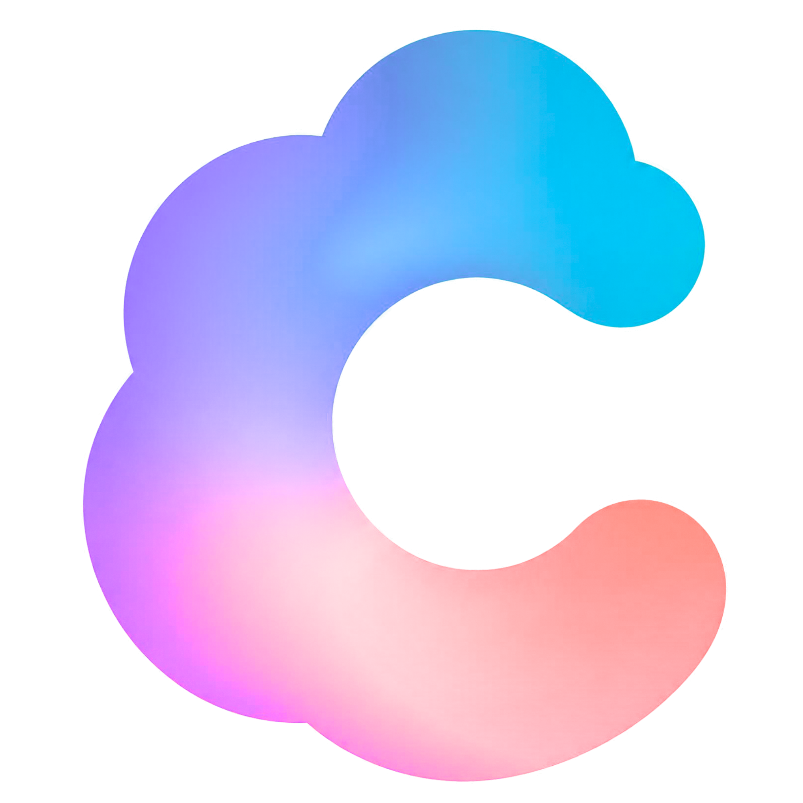
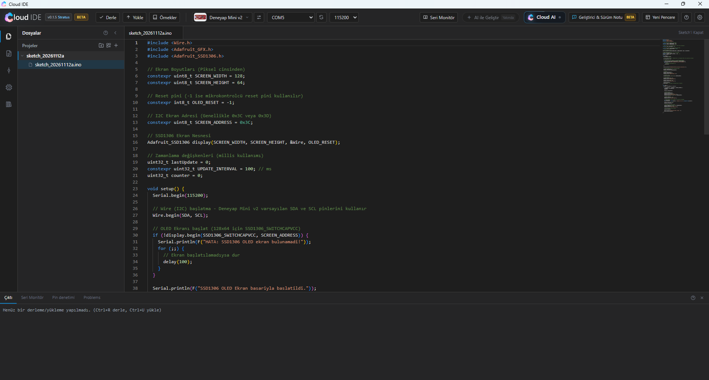
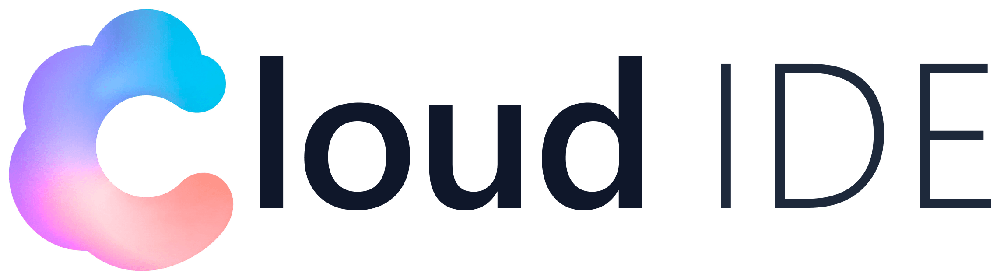

<p align="center">
  
</p>

<h1 align="center">Cloud IDE</h1>
<p align="center"><b>AI-powered desktop development environment for Arduino and ESP · English and Turkish interface</b></p>

<p align="center"><a href="README.md">Türkçe</a> · <b>English</b></p>

<p align="center">
  
  
  
  
  
</p>

<p align="center">
  
  
  
  
  
  
</p>

<p align="center">
  <b>⚡ Built-in CLI</b> · Zero setup&nbsp;&nbsp;|&nbsp;&nbsp;
  <b>🤖 Cloud AI</b> · Writes, builds, fixes&nbsp;&nbsp;|&nbsp;&nbsp;
  <b>🕘 Version history</b> · Go back in time
</p>

---

**Cloud IDE** brings the core features of the Arduino IDE (code editing, building, uploading to the board, board and library management, serial monitor) together in a modern interface, and adds the **Cloud AI** assistant, pin checking, a wiring guide, version history and ready-made project templates on top. Thanks to the built-in `arduino-cli`, it runs on any Windows computer without a separate Arduino IDE installation; Linux support is experimental. The interface is available in **English** and **Turkish**.

## 📋 Table of Contents
- [From the Developer](#-from-the-developer)
- [Features](#-features)
- [Tech Stack](#-tech-stack)
- [Screenshots](#-screenshots)
- [Installation](#-installation)
- [Development](#-development)
- [Project Structure](#-project-structure)
- [Privacy and Security](#-privacy-and-security)
- [Roadmap](#-roadmap)
- [Contributing](#-contributing)
- [Image Credits](#-image-credits)
- [Third-Party Software](#-third-party-software)
- [License](#-license)
- [Developer](#-developer)

## 💬 From the Developer

> "With AI you can now do almost anything, but the most important and irreplaceable thing will always be human input, direction and originality."
>
> — Efe Ali Bozkurt, creator of Cloud IDE

The vision behind Cloud IDE is that even people who don't know coding or embedded systems should be able to build the physical projects they have in mind, and that the technical barriers in front of hardware and software development should come down.

## ✨ Features

### 🤖 Cloud AI assistant
- An **agent** that can read your project, write and edit files, build, and try to fix errors
- **You control changes:** Approval (shows the diff before writing files), Semi-automatic, Fully automatic. The changes from each reply can be undone with one click
- Providers: DeepSeek, OpenAI, Anthropic (Claude), Google Gemini, Kimi, NVIDIA NIM and local **Ollama / LM Studio** (works offline)
- **Live code writing:** the AI's change streams into the editor line by line (skip with **Esc**); when it finishes, **Accept** or **Undo** from the bar at the top right (the old code comes back both in the editor and on disk)
- **Fix with AI**, **Explain** and **Write a prompt** for selected code; one-click "what does this mean?" for build errors
- Automatic summarization of long chats, AI-generated chat titles, context meter
- Local **knowledge base (RAG)**: combines semantic and keyword search over board information, library APIs and your own custom notes

### 🔌 Pin checking and board information
- Catches pin mistakes for the selected board before the code runs: non-existent pins, pins without PWM/interrupt support, ESP32 flash and input-only pins, ADC2 while Wi-Fi is on, Servo conflicts
- **Pin map** of the selected board (PWM, analog, interrupt, I2C, SPI…), with the pins used in your code highlighted
- Ready for Arduino Uno/Nano/Mega, ESP32 and ESP8266; board picker with photos, including Deneyap boards

### 🔗 Wiring guide
- A **wiring diagram** extracted automatically from your code for the selected board: VCC, GND and signal connections of sensors, displays, motors and modules, with wire colors
- Required resistors, pull-ups, 5V→3.3V voltage dividers and external power warnings
- A **"Connected" checklist** for every wire with a progress indicator; can be opened in a large window
- Optionally, **Cloud AI** reads the code, enriches the guide using the board's rules and saves it to the project as `BAGLANTI.json`

### ✍️ Editor
- Monaco-based editor with offline **code completion** that knows your installed libraries, signature help and hover descriptions
- Dark, light and high-contrast themes, adjustable font size, multiple tabs and a multi-project workspace

### ⚙️ Build and upload
- Zero-setup, built-in `arduino-cli` core
- **Flash/RAM** usage after building; error lines and one-click **installation of missing libraries**
- **Board settings** (processor, partition scheme, upload speed…) and **automatic detection** of boards plugged in over USB
- Port coordination that keeps building and uploading safe

### 📟 Serial monitor
- **Multiple ports**: watch several boards at the same time in tabs
- **Live plot** (`value`, `1,2,3` or `label:value` formats), timestamps, bootloader output hiding

### 🕘 Version history
- Per-project snapshots, side-by-side comparison, restore, tags and branches
- Build information (board, library versions, memory usage) is stored with each version
- Automatic snapshots; export/import a project together with its history as a `.zip`

### 🧩 Templates and notes
- **Ready-made project templates** from a blinking LED to DHT, HC-SR04, servo, NeoPixel, OLED and a Wi-Fi web page; fill in the pins and get the wiring diagram and libraries ready
- Per-project **notes** (checkbox to-dos, "fill from code"), versioned together with the code

### 🌍 Language support
- **English** and **Turkish** interface; the language is asked on first launch and can be changed later in **Settings › General**
- With English selected, some built-in AI prompts (e.g. "Explain") and the wiring guide are also produced in English

### 📦 Management and usability
- Board and library manager; **library update** notifications
- **First-run setup wizard:** walks you through choosing a board and an AI provider
- In-app **help and guide** (F1), getting-started tour, **update checks** via GitHub
- **Report a problem:** prepares a report from system, board, build output and logs with one click; automatically hides personal information (paths, user name, keys, e-mail, IP, Wi-Fi details). You see the full report before sharing, then copy it, save it to a file or open it as a GitHub issue
- **Custom skills**: define your own C++ snippets and architecture rules as `.md` files

## 🧰 Tech Stack

| Layer | Technologies |
|---|---|
| Desktop framework | Electron |
| Interface | React 18 · TypeScript · Tailwind CSS · Vite |
| Code editor | Monaco Editor |
| AI / RAG | Provider APIs · `@xenova/transformers` (local embedding model) |
| Hardware communication | `serialport` |
| Persistent storage | `electron-store` |
| Updates | `electron-updater` (GitHub Releases) |
| Packaging | electron-builder (Windows: NSIS Setup + Portable · Linux: AppImage + .deb, experimental) |
| Built-in compiler | `arduino-cli` v1.5.1 |

## 📸 Screenshots

<p align="center">
  
</p>
<p align="center"><sub>Editor, board and port selection, Build / Upload, Cloud AI and the bottom panels (Output, Serial Monitor, Pin check, Problems)</sub></p>

## 🚀 Installation

1. Download the latest `Setup.exe` (installer) or portable `.exe` from the [Releases](https://github.com/efealibozkurt/Cloud-IDE/releases) page.
2. Follow the setup wizard, or run the portable version directly.
3. No separate Arduino IDE installation is needed; the compiler is bundled.
4. For Cloud AI, enter a provider and API key under **Settings › AI**, or use a local model (Ollama / LM Studio).

> The beta is not code-signed yet; Windows SmartScreen may show a warning on first install (**More info › Run anyway**).

> On first launch you choose a language and a short tour starts; press **F1** for help whenever you get stuck.

**Linux (experimental):** if the Releases page has an `.AppImage` or `.deb` file, use it; otherwise run from source (see [Linux](#-linux)). Your user must be in the `dialout` group to upload to a board.

## 🛠️ Development

```bash
git clone https://github.com/efealibozkurt/Cloud-IDE.git
cd Cloud-IDE
npm install

npm run dev          # run in development mode
npm run typecheck    # type checking
npm run lint         # ESLint
npm test             # unit tests (Vitest)
npm run build:setup  # Windows installer (NSIS): release/Cloud-IDE-Setup-<version>.exe
npm run build:win    # Setup + Portable
npm run build:linux  # Linux: AppImage + .deb (on Linux only)
```

For automatic updates, `Cloud-IDE-Setup-<version>.exe`, its `.blockmap` and `latest.yml` must be uploaded together to a GitHub release.

The bundled `arduino-cli.exe` is not in the repository; place it in the `resources/arduino-cli/` folder.

### 🐧 Linux

Linux packages (AppImage and .deb) cannot be built on Windows; the **Actions › Linux derlemesi** workflow on GitHub
builds them on Ubuntu (triggered manually or by a `v*` tag). To build on a Linux machine yourself:

```bash
npm ci
npm run arduino-cli:indir -- linux x64   # downloads the official arduino-cli and verifies its SHA-256
npm run build:linux                       # release/Cloud-IDE-<version>-x86_64.AppImage and cloud-ide_<version>_amd64.deb
```

- **Serial port permission:** to upload and use the Serial Monitor, your user must be in the `dialout` group
  (`uucp` on Arch-based distributions): `sudo usermod -aG dialout $USER`, then log out and back in.
- **Blank window:** on some drivers and virtual machines, GPU acceleration leads to a blank window. Start the app
  with the `--disable-gpu` argument or the `CLOUD_IDE_GPU_KAPALI=1` environment variable.
- **arduino-cli:** bundled in the packages; in development mode (`npm run dev`) it must be installed on the system
  (`~/.local/bin`, `~/bin`, `/usr/local/bin`, `/usr/bin` and `/snap/bin` are searched) or downloaded with the script above.
- For automatic updates, upload `latest-linux.yml` to the release together with the AppImage.

## 🗂️ Project Structure

<details>
<summary>Show folder map</summary>

```
Cloud-IDE/
├─ .github/workflows/    # Linux build workflow (GitHub Actions)
├─ resources/            # icons, bundled arduino-cli and its license files
├─ scripts/              # icon/logo generation, arduino-cli download script
├─ src/
│  ├─ main/              # Electron main process
│  │  ├─ ipc/            # IPC handlers (validated)
│  │  └─ services/       # arduino-cli, agent, RAG, history, updates…
│  ├─ preload/           # secure bridge (contextBridge)
│  ├─ renderer/src/      # React interface
│  │  ├─ components/     # editor, ai, layout, boards, libraries, history, notes, settings…
│  │  ├─ i18n/           # Turkish/English language support (en.ts dictionary)
│  │  ├─ state/          # app, agent and help contexts
│  │  ├─ hooks/ utils/
│  └─ shared/            # shared types and pure logic (pin check, wiring guide, templates, FQBN…)
└─ electron-builder.yml
```
</details>

## 🔒 Privacy and Security
- API keys are stored only on your computer, encrypted at the operating-system level, and are never sent back to the interface.
- Cloud AI only accesses the projects in your workspace; writing and deleting files is submitted for your approval by default.
- Update checks only look at the release information on GitHub; no usage data is sent, and updates are not downloaded without your approval.
- With local models, nothing leaves your computer.
- Every operation between the interface and the main process is validated: file paths and extensions, arduino-cli parameters and serial port values are checked; external links open only as `https`/`http`/`mailto`; the app window cannot be redirected to another page.
- Problem reports are never sent automatically; personal information is removed and your code is not included by default.

## 🗺️ Roadmap

**Current status: v0.1.8 "Stratus" (Beta)**
This version includes the editor, build/upload, the Cloud AI agent with live code writing, pin checking, the wiring guide, version history, templates, notes, an English/Turkish interface and one-click problem reporting. Linux support is experimental.

**Next**
- Command palette and code linting (catching common mistakes)
- Automatic serial port reconnection
- Pin maps and rules for more boards

**Long-term vision**
- From circuit diagram generation to pin connections
- From simulation to physical hardware testing
- A **fully AI-assisted** autonomous development mode from start to finish

Every version carries the name of a cloud (Stratus → Cumulus → Altostratus → Nimbostratus → Cumulonimbus); as the project grows, the cloud rises.

## 🤝 Contributing
Contributions are welcome! You can open an [issue](https://github.com/efealibozkurt/Cloud-IDE/issues) or send a pull request directly. Since this is a beta, every bit of feedback is very valuable.

## 🖼️ Image Credits
The board photos in the board picker come from Wikimedia Commons (Creative Commons) and the official Deneyap board documentation. The author and license of each image are listed in [`CREDITS.md`](src/renderer/src/assets/boards/CREDITS.md).

## 🧩 Third-Party Software

Cloud IDE is built on the following open-source software. Each is under its own license; copyrights belong to their owners.

**Program distributed with the app**

| Software | Version | Copyright | License | Source code |
|---|---|---|---|---|
| [Arduino CLI](https://github.com/arduino/arduino-cli) | 1.5.1 | Arduino SA | GPL-3.0 | [v1.5.1 tag](https://github.com/arduino/arduino-cli/tree/v1.5.1) |

Arduino CLI is included unmodified as a separate program, and Cloud IDE runs it as a separate process. Its license text and notice are in the installation folder under `resources/arduino-cli/` (`LICENSE.txt`, `NOTICE.txt`). The source code of this version is available at the link above.

**Main libraries**

| Software | License |
|---|---|
| [Electron](https://www.electronjs.org/) (includes Chromium and Node.js) | MIT; Chromium component licenses are in `LICENSES.chromium.html` in the package |
| [React](https://react.dev/) | MIT |
| [Monaco Editor](https://github.com/microsoft/monaco-editor) | MIT |
| [Transformers.js](https://github.com/xenova/transformers.js) | Apache-2.0 |
| [ONNX Runtime](https://github.com/microsoft/onnxruntime) | MIT |
| [Node SerialPort](https://serialport.io/) | MIT |
| [electron-store](https://github.com/sindresorhus/electron-store), [electron-updater](https://github.com/electron-userland/electron-builder) | MIT |
| [Tailwind CSS](https://tailwindcss.com/) | MIT |

The full list of dependencies and their licenses is in `package.json` and the packages under `node_modules`.

**AI model**

The local knowledge base search uses the [multilingual-e5-small](https://huggingface.co/intfloat/multilingual-e5-small) embedding model (Microsoft, MIT license; [Xenova](https://huggingface.co/Xenova/multilingual-e5-small) ONNX conversion), downloaded on first use. The model is not distributed in the app package.

**Trademark notice**

"Arduino" and the Arduino logo are registered trademarks of Arduino SA. The "Deneyap" name and logo belong to their respective owners. Cloud IDE is an independent project; it is not affiliated with or endorsed by Arduino SA or Deneyap. These names are used only to describe compatible hardware.

## 📄 License

Copyright © 2026 Efe Ali Bozkurt &lt;iletisim@efealibozkurt.com.tr&gt;

This project is licensed under the **GNU General Public License v3.0 (GPL-3.0)**. See the [LICENSE](LICENSE) file for the full terms and your legal rights.

## 👤 Developer

**Efe Ali Bozkurt** — Creator of Cloud IDE

<p align="left">
  <a href="https://github.com/efealibozkurt"></a>
  <a href="mailto:iletisim@efealibozkurt.com.tr"></a>
</p>

<p align="center">
  <picture>
    <source media="(prefers-color-scheme: dark)" srcset="src/renderer/src/assets/beyaz_cloud_ide.png">
    <source media="(prefers-color-scheme: light)" srcset="src/renderer/src/assets/siyah_cloud_ide.png">
    
  </picture>
</p>
