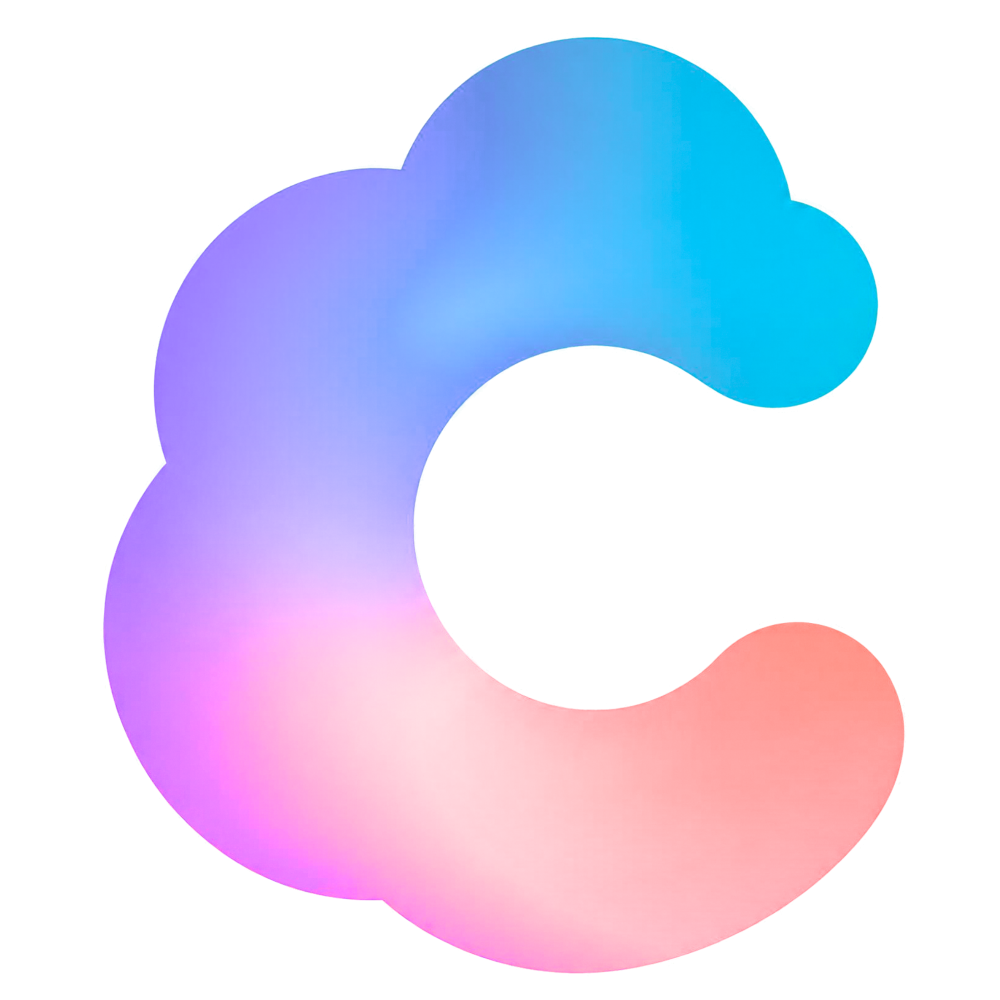
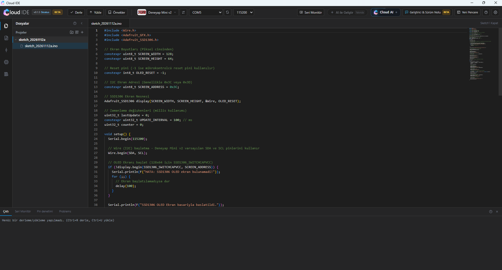
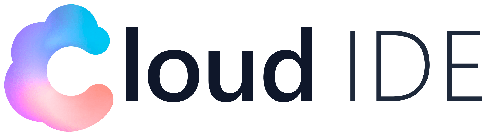

<p align="center">
  
</p>

<h1 align="center">Cloud IDE</h1>
<p align="center"><b>Arduino ve ESP için yapay zekâ destekli masaüstü geliştirme ortamı · Türkçe ve İngilizce arayüz</b></p>

<p align="center"><b>Türkçe</b> · <a href="README.en.md">English</a></p>

<p align="center">
  
  
  
  
  
</p>

<p align="center">
  
  
  
  
  
  
</p>

<p align="center">
  <b>⚡ Gömülü CLI</b> · Sıfır kurulum&nbsp;&nbsp;|&nbsp;&nbsp;
  <b>🤖 Cloud AI</b> · Yazar, derler, düzeltir&nbsp;&nbsp;|&nbsp;&nbsp;
  <b>🕘 Sürüm geçmişi</b> · Eski hallere dönün
</p>

---

**Cloud IDE**, Arduino IDE'nin temel işlevlerini (kod düzenleme, derleme, karta yükleme, kart ve kütüphane yönetimi, seri monitör) modern bir arayüzde birleştirir; üstüne **Cloud AI** asistanını, pin denetimini, bağlantı kılavuzunu, sürüm geçmişini ve hazır proje şablonlarını ekler. Gömülü `arduino-cli` sayesinde harici bir Arduino IDE kurulumuna gerek kalmadan her Windows bilgisayarda çalışır; Linux desteği deneysel aşamadadır. Arayüz **Türkçe** ve **İngilizce** kullanılabilir.

## 📋 İçindekiler
- [Geliştiriciden](#-geliştiriciden)
- [Özellikler](#-özellikler)
- [Teknoloji Yığını](#-teknoloji-yığını)
- [Ekran Görüntüleri](#-ekran-görüntüleri)
- [Kurulum](#-kurulum)
- [Geliştirme](#-geliştirme)
- [Proje Yapısı](#-proje-yapısı)
- [Gizlilik ve Güvenlik](#-gizlilik-ve-güvenlik)
- [Yol Haritası](#-yol-haritası)
- [Katkıda Bulunma](#-katkıda-bulunma)
- [Görsel Kaynakları](#-görsel-kaynakları)
- [Üçüncü Taraf Yazılımlar](#-üçüncü-taraf-yazılımlar)
- [Lisans](#-lisans)
- [Geliştirici](#-geliştirici)

## 💬 Geliştiriciden

> "AI ile artık her şeyi yapabilirsiniz, ancak en önemli ve vazgeçilmez olan şey daima insanın yaptığı müdahale, yönlendirme ve özgünlüktür."
>
> — Efe Ali Bozkurt, Cloud IDE Yaratıcısı

Kodlama ve gömülü sistemler bilmeyen insanların dahi aklındaki fiziksel projeleri üretebilmesi, donanım ve yazılım geliştirme önündeki teknik sınırların kalkması gerektiği düşüncesiyle yola çıkılan bu proje, Cloud IDE'nin vizyonunu oluşturuyor.

## ✨ Özellikler

### 🤖 Cloud AI asistanı
- Projenizi okuyabilen, dosya yazıp düzenleyebilen, derleyip hataları düzeltmeyi deneyen bir **agent**
- **Değişiklik izni sizde:** Onaylı (dosya yazmadan önce farkı gösterir), Yarı otomatik, Tam otomatik. Her yanıttaki değişiklikler tek tıkla geri alınabilir
- Sağlayıcılar: DeepSeek, OpenAI, Anthropic (Claude), Google Gemini, Kimi, NVIDIA NIM ve yerel **Ollama / LM Studio** (internetsiz çalışır)
- **Canlı kod yazımı:** AI'ın yaptığı değişiklik editöre satır satır akarak yazılır (**Esc** ile atlanır); bitince sağ üstteki çubuktan **Onayla** ya da **Geri Al** (eski kod hem editörde hem diskte geri gelir)
- Seçili kod için **AI ile Düzelt**, **Açıkla** ve **Prompt Gir**; derleme hatası için tek tıkla "bu ne demek?"
- Uzun sohbetlerde otomatik özetleme, sohbet başlıklarını yapay zekâyla üretme, bağlam göstergesi
- Yerel **bilgi tabanı (RAG)**: kart bilgileri, kütüphane API'leri ve kendi özel notlarınızla anlamsal + sözcük aramasını birleştirir

### 🔌 Pin denetimi ve kart bilgisi
- Seçili karta göre pin hatalarını kod çalışmadan yakalar: olmayan pin, PWM/kesme desteklemeyen pin, ESP32 flash ve yalnızca-giriş pinleri, Wi-Fi varken ADC2, Servo çakışmaları
- Seçili kartın **pin haritası** (PWM, analog, kesme, I2C, SPI…); kodda kullandığınız pinler işaretli
- Arduino Uno/Nano/Mega, ESP32 ve ESP8266 için hazır; Deneyap kartları dahil kart fotoğraflı kart seçici

### 🔗 Bağlantı kılavuzu
- Koddan otomatik çıkarılan, seçili karta göre **kablolama şeması**: sensör, ekran, motor ve modüllerin VCC, GND ve sinyal bağlantıları kablo renkleriyle
- Gereken dirençler, pull-up, 5V→3.3V gerilim bölücü ve harici güç uyarıları
- Her kablo için **"Bağladım" kontrol listesi** ve ilerleme göstergesi; büyük pencerede açılabilir
- İsterseniz **Cloud AI** kodu okuyup kılavuzu kart kurallarına göre zenginleştirir ve projeye `BAGLANTI.json` olarak kaydeder

### ✍️ Editör
- Monaco tabanlı editör; kurulu kütüphanelerinizi tanıyan çevrimdışı **kod tamamlama**, imza yardımı ve açıklamalar
- Koyu, açık ve yüksek karşıtlıklı temalar, ayarlanabilir yazı boyutu, çoklu sekme ve çoklu proje çalışma alanı

### ⚙️ Derleme ve yükleme
- Sıfır kurulumlu, gömülü `arduino-cli` çekirdeği
- Derleme sonrası **Flash/RAM** göstergesi; hata satırları ve tek tıkla **eksik kütüphane kurulumu**
- **Kart ayarları** (işlemci, bölüm şeması, yükleme hızı…) ve USB'ye takılan kartı **otomatik tanıma**
- Derleme ve yüklemeyi güvenli yöneten port koordinasyonu

### 📟 Seri monitör
- **Çoklu port**: birden çok kartı sekmelerle aynı anda izleme
- **Canlı grafik** (`değer`, `1,2,3` ya da `etiket:değer` biçimleri), zaman damgası, bootloader gizleme

### 🕘 Sürüm geçmişi
- Projeye özel kayıt, karşılaştırma (yan yana fark), geri yükleme, etiket ve dal
- Derleme bilgisi (kart, kütüphane sürümleri, bellek kullanımı) sürümle birlikte saklanır
- Otomatik anlık görüntüler; projeyi geçmişiyle birlikte `.zip` olarak dışa/içe aktarma

### 🧩 Şablonlar ve notlar
- LED'den DHT, HC-SR04, servo, NeoPixel, OLED ve Wi-Fi web sayfasına **hazır proje şablonları**; pinleri doldurun, bağlantı şeması ve kütüphaneler hazır gelsin
- Projeye özel **notlar** (onay kutulu yapılacaklar, "koddan doldur"), kodla birlikte sürümlenir

### 🌍 Dil desteği
- Arayüz **Türkçe** ve **İngilizce**; ilk açılışta dil sorulur, sonradan **Ayarlar › Genel** bölümünden değiştirilir
- İngilizce seçiliyken bazı hazır AI istemleri (ör. "Açıkla") ve bağlantı kılavuzu da İngilizce üretilir

### 📦 Yönetim ve kullanım
- Kart ve kütüphane yöneticisi; **kütüphane güncelleme** bildirimi
- **İlk kurulum sihirbazı:** kart ve yapay zekâ sağlayıcısını adım adım seçtirir
- Uygulama içi **yardım ve rehber** (F1), ilk açılış turu, GitHub üzerinden **güncelleme denetimi**
- **Sorun bildir:** sistem, kart, derleme çıktısı ve günlükten tek tıkla rapor hazırlar; kişisel bilgileri (yol, kullanıcı adı, anahtar, e-posta, IP, Wi-Fi bilgisi) otomatik gizler. Paylaşmadan önce tamamını görür, panoya kopyalar, dosyaya kaydeder ya da GitHub'da sorun olarak açarsınız
- Kendi C++ parçacıklarınızı ve mimari kurallarınızı `.md` olarak tanımlayan **özel beceriler**

## 🧰 Teknoloji Yığını

| Katman | Teknolojiler |
|---|---|
| Masaüstü Çatısı | Electron |
| Arayüz | React 18 · TypeScript · Tailwind CSS · Vite |
| Kod Editörü | Monaco Editor |
| AI / RAG | Sağlayıcı API'leri · `@xenova/transformers` (yerel gömme modeli) |
| Donanım İletişimi | `serialport` |
| Kalıcı Depolama | `electron-store` |
| Güncelleme | `electron-updater` (GitHub Releases) |
| Paketleme | electron-builder (Windows: NSIS Setup + Portable · Linux: AppImage + .deb, deneysel) |
| Gömülü Derleyici | `arduino-cli` v1.5.1 |

## 📸 Ekran Görüntüleri

<p align="center">
  
</p>
<p align="center"><sub>Editör, kart ve port seçimi, Derle / Yükle, Cloud AI ve alt paneller (Çıktı, Seri Monitör, Pin denetimi, Problems)</sub></p>

## 🚀 Kurulum

1. [Releases](https://github.com/efealibozkurt/Cloud-IDE/releases) sayfasından güncel `Setup.exe` (kurulum) veya portable `.exe` dosyasını indirin.
2. Kurulum sihirbazını takip edin ya da portable sürümü doğrudan çalıştırın.
3. Harici bir Arduino IDE kurulumuna gerek yoktur; derleyici pakete gömülüdür.
4. Cloud AI için **Ayarlar › Yapay zekâ** bölümünden bir sağlayıcı ve API anahtarı girin ya da yerel bir model (Ollama / LM Studio) kullanın.

> Beta sürüm henüz kod imzalı değildir; ilk kurulumda Windows SmartScreen uyarısı çıkabilir (**Ek bilgi › Yine de çalıştır**).

> İlk açılışta dil seçimi ve kısa bir tur başlar; takıldığınız yerde **F1** ile yardımı açabilirsiniz.

**Linux (deneysel):** Releases sayfasında `.AppImage` ya da `.deb` dosyası varsa onu kullanın; yoksa kaynak koddan çalıştırın (bkz. [Linux](#-linux)). Karta yükleme için kullanıcınızın `dialout` grubunda olması gerekir.

## 🛠️ Geliştirme

```bash
git clone https://github.com/efealibozkurt/Cloud-IDE.git
cd Cloud-IDE
npm install

npm run dev          # geliştirme modunda çalıştır
npm run typecheck    # tip denetimi
npm run lint         # ESLint
npm test             # birim testleri (Vitest)
npm run build:setup  # Windows kurulum dosyası (NSIS): release/Cloud-IDE-Setup-<sürüm>.exe
npm run build:win    # Setup + Portable
npm run build:linux  # Linux: AppImage + .deb (yalnızca Linux'ta)
```

Otomatik güncelleme için bir GitHub sürümüne `Cloud-IDE-Setup-<sürüm>.exe`, `.blockmap` ve `latest.yml` dosyaları birlikte yüklenmelidir.

Gömülü `arduino-cli.exe` dosyası depoda bulunmaz; `resources/arduino-cli/` klasörüne yerleştirilmelidir.

### 🐧 Linux

Linux kurulum dosyaları (AppImage ve .deb) Windows'ta üretilemez; GitHub'daki **Actions › Linux derlemesi** iş akışı
bunları Ubuntu üzerinde üretir (elle ya da `v*` etiketiyle tetiklenir). Linux makinede kendiniz derlemek için:

```bash
npm ci
npm run arduino-cli:indir -- linux x64   # resmi arduino-cli'yi indirir, SHA-256 ile doğrular
npm run build:linux                       # release/Cloud-IDE-<sürüm>-x86_64.AppImage ve cloud-ide_<sürüm>_amd64.deb
```

- **Seri port izni:** karta yükleme ve Seri Monitör için kullanıcınız `dialout` grubunda olmalıdır
  (Arch tabanlı dağıtımlarda `uucp`): `sudo usermod -aG dialout $USER`, ardından oturumu kapatıp açın.
- **Boş pencere:** bazı sürücülerde/sanal makinelerde GPU hızlandırması boş pencereye yol açar. Uygulamayı
  `--disable-gpu` argümanıyla ya da `CLOUD_IDE_GPU_KAPALI=1` ortam değişkeniyle başlatın.
- **arduino-cli:** pakette gömülü gelir; geliştirme modunda (`npm run dev`) ise sistemde kurulu olmalı
  (`~/.local/bin`, `~/bin`, `/usr/local/bin`, `/usr/bin` ve `/snap/bin` taranır) ya da yukarıdaki betikle indirilmelidir.
- Otomatik güncelleme için Release'e AppImage ile birlikte `latest-linux.yml` de yüklenmelidir.

## 🗂️ Proje Yapısı

<details>
<summary>Klasör haritasını göster</summary>

```
Cloud-IDE/
├─ .github/workflows/    # Linux derleme iş akışı (GitHub Actions)
├─ resources/            # ikonlar, gömülü arduino-cli ve lisans dosyaları
├─ scripts/              # ikon/logo üretimi, arduino-cli indirme betiği
├─ src/
│  ├─ main/              # Electron ana süreç
│  │  ├─ ipc/            # IPC uçları (doğrulamalı)
│  │  └─ services/       # arduino-cli, agent, RAG, geçmiş, güncelleme…
│  ├─ preload/           # güvenli köprü (contextBridge)
│  ├─ renderer/src/      # React arayüzü
│  │  ├─ components/     # editor, ai, layout, boards, libraries, history, notes, settings…
│  │  ├─ i18n/           # Türkçe/İngilizce dil desteği (en.ts sözlüğü)
│  │  ├─ state/          # uygulama, agent, yardım bağlamları
│  │  ├─ hooks/ utils/
│  └─ shared/            # ortak tipler ve saf mantık (pin denetimi, bağlantı kılavuzu, şablonlar, FQBN…)
└─ electron-builder.yml
```
</details>

## 🔒 Gizlilik ve Güvenlik
- API anahtarları yalnızca bilgisayarınızda, işletim sistemi düzeyinde şifrelenerek saklanır; arayüze geri döndürülmez.
- Cloud AI yalnızca çalışma alanınızdaki projelere erişir; dosya yazma ve silme işlemleri varsayılan olarak onayınıza sunulur.
- Güncelleme denetimi yalnızca GitHub'daki sürüm bilgisine bakar; hiçbir kullanım verisi gönderilmez ve güncelleme onayınız olmadan indirilmez.
- Yerel modellerle hiçbir şey internete çıkmaz.
- Arayüz ile ana süreç arasındaki tüm işlemler doğrulanır: dosya yolları ve uzantıları, arduino-cli parametreleri ve seri port değerleri denetlenir; dış bağlantılar yalnızca `https`/`http`/`mailto` olarak açılır; uygulama penceresi başka bir sayfaya yönlendirilemez.
- Sorun raporları kendiliğinden gönderilmez; kişisel bilgiler temizlenir ve kodunuz varsayılan olarak rapora girmez.

## 🗺️ Yol Haritası

**Şu anki durum: v0.1.8 "Stratus" (Beta)**
Editör, derleme/yükleme, Cloud AI agent'ı ve canlı kod yazımı, pin denetimi, bağlantı kılavuzu, sürüm geçmişi, şablonlar, notlar, Türkçe/İngilizce arayüz ve tek tıkla sorun bildirme bu sürümde. Linux desteği deneysel.

**Sırada**
- Komut paleti ve kod denetimi (sık yapılan hataları yakalama)
- Seri portun otomatik yeniden bağlanması
- Daha fazla kart için pin haritası ve kural desteği

**Uzun vadeli vizyon**
- Devre şeması üretiminden pin bağlantılarına
- Simülasyondan donanımın fiziksel testine kadar
- Baştan sona **Full AI destekli** otonom geliştirme modu

Her sürüm bir bulut adı taşır (Stratus → Cumulus → Altostratus → Nimbostratus → Cumulonimbus); proje geliştikçe bulut yükselir.

## 🤝 Katkıda Bulunma
Katkılar memnuniyetle karşılanır! Bir [issue](https://github.com/efealibozkurt/Cloud-IDE/issues) açabilir veya doğrudan pull request gönderebilirsiniz. Beta sürüm olduğu için her türlü geri bildirim çok değerlidir.

## 🖼️ Görsel Kaynakları
Kart seçicideki kart fotoğrafları Wikimedia Commons (Creative Commons) ve resmi Deneyap kart belgelerinden alınmıştır. Her görselin yazarı ve lisansı [`CREDITS.md`](src/renderer/src/assets/boards/CREDITS.md) dosyasında listelenir.

## 🧩 Üçüncü Taraf Yazılımlar

Cloud IDE aşağıdaki açık kaynak yazılımlar üzerine kuruludur. Her biri kendi lisansı altındadır; telif hakları sahiplerine aittir.

**Uygulamayla birlikte dağıtılan program**

| Yazılım | Sürüm | Telif | Lisans | Kaynak kod |
|---|---|---|---|---|
| [Arduino CLI](https://github.com/arduino/arduino-cli) | 1.5.1 | Arduino SA | GPL-3.0 | [v1.5.1 etiketi](https://github.com/arduino/arduino-cli/tree/v1.5.1) |

Arduino CLI değiştirilmeden, ayrı bir program olarak pakete eklenir ve Cloud IDE tarafından ayrı bir süreç olarak çalıştırılır. Lisans metni ve bildirim, kurulum klasöründe `resources/arduino-cli/` altında (`LICENSE.txt`, `NOTICE.txt`) yer alır. Bu sürümün kaynak koduna yukarıdaki bağlantıdan ulaşılabilir.

**Başlıca kütüphaneler**

| Yazılım | Lisans |
|---|---|
| [Electron](https://www.electronjs.org/) (Chromium ve Node.js içerir) | MIT; Chromium bileşen lisansları paketteki `LICENSES.chromium.html` dosyasındadır |
| [React](https://react.dev/) | MIT |
| [Monaco Editor](https://github.com/microsoft/monaco-editor) | MIT |
| [Transformers.js](https://github.com/xenova/transformers.js) | Apache-2.0 |
| [ONNX Runtime](https://github.com/microsoft/onnxruntime) | MIT |
| [Node SerialPort](https://serialport.io/) | MIT |
| [electron-store](https://github.com/sindresorhus/electron-store), [electron-updater](https://github.com/electron-userland/electron-builder) | MIT |
| [Tailwind CSS](https://tailwindcss.com/) | MIT |

Tüm bağımlılıkların tam listesi ve lisansları `package.json` ile `node_modules` içindeki paketlerde bulunur.

**Yapay zekâ modeli**

Yerel bilgi tabanı araması, ilk kullanımda indirilen [multilingual-e5-small](https://huggingface.co/intfloat/multilingual-e5-small) gömme modelini (Microsoft, MIT lisansı; [Xenova](https://huggingface.co/Xenova/multilingual-e5-small) ONNX dönüşümü) kullanır. Model uygulama paketinde dağıtılmaz.

**Marka bildirimi**

"Arduino" ve Arduino logosu Arduino SA'nın tescilli markalarıdır. "Deneyap" adı ve logosu ilgili hak sahiplerine aittir. Cloud IDE bağımsız bir projedir; Arduino SA veya Deneyap ile bağlantılı değildir ve onlar tarafından onaylanmamıştır. Bu adlar yalnızca uyumlu donanımı tanımlamak için kullanılır.

## 📄 Lisans

Copyright © 2026 Efe Ali Bozkurt &lt;iletisim@efealibozkurt.com.tr&gt;

Bu proje **GNU General Public License v3.0 (GPL-3.0)** altında lisanslanmıştır. Ayrıntılı lisans şartları ve yasal haklar için [LICENSE](LICENSE) dosyasına göz atabilirsiniz.

## 👤 Geliştirici

**Efe Ali Bozkurt** — Cloud IDE Yaratıcısı

<p align="left">
  <a href="https://github.com/efealibozkurt"></a>
  <a href="mailto:iletisim@efealibozkurt.com.tr"></a>
</p>

<p align="center">
  <picture>
    <source media="(prefers-color-scheme: dark)" srcset="src/renderer/src/assets/beyaz_cloud_ide.png">
    <source media="(prefers-color-scheme: light)" srcset="src/renderer/src/assets/siyah_cloud_ide.png">
    
  </picture>
</p>
